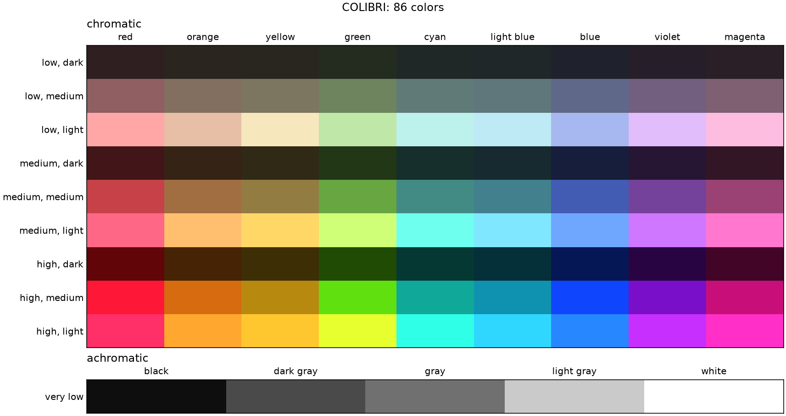
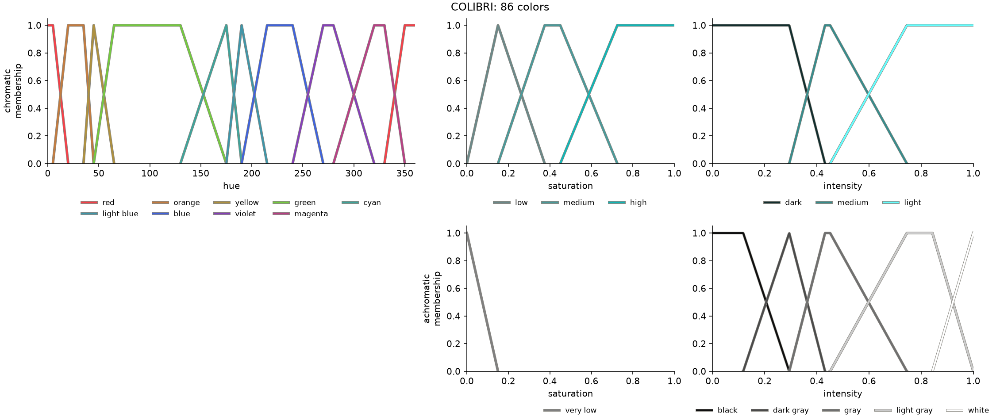

# color

People name colors loosely: an orange-red pixel is mostly orange, a little red.
A fuzzy color model says it in numbers, a degree from 0 to 1 for every color.

```python
import numpy as np
from emoge import color
```

Everything below is at `color.`.

## Naming colors

COLIBRI names 86 colors, after a survey of how people name them.

```python
image = np.array([[[200, 30, 30], [250, 220, 40]], [[30, 60, 200], [20, 20, 20]]])
print(color.COLIBRI.label(image).tolist())
# [['red/high/dark', 'yellow/high/light'], ['blue/high/medium', 'black']]

degrees = color.COLIBRI.degrees([230, 90, 40])  # an orange-red pixel
for i in np.argsort(-degrees)[:2]:
    print(color.COLIBRI.colors[i], round(float(degrees[i]), 2))
# orange/high/medium 0.48
# red/high/medium 0.26
```

| Method | Gives |
|---|---|
| `degrees(rgb)` | the degree of every pixel in every color |
| `label(rgb)`, `classify(rgb)` | the strongest color: its name, or its index in `colors` |
| `strongest(rgb)` | the index of the strongest color and its degree |
| `palette(image, weights)` | how much of the image each color takes; with `weights`, a mask or a stack of masks, how much of each region |
| `cooccurrence(image, distance)` | how often every two colors are neighbours, as below |
| `prototypes()` | a typical RGB color for every color, as below |



For many images, `color.lookup_table(color.COLIBRI, "colibri.npz")` classifies
every 8-bit pixel once and keeps the table in that file, 0.6 MB compressed; then
`table[red, green, blue]` classifies a whole image at once. `degree=True` keeps
the degree of each color too, in steps of 1/255.

Any segmentation gives regions: its label map, `labels`, becomes a stack of
masks with `labels == np.arange(labels.max() + 1)[:, None, None]`, and
`palette(image, masks)` is then the palette of every region.

## How a model works

A pixel first becomes hue, saturation and intensity, the channels of `HSI`.
Each channel is described by words, its terms, such as gray, pale and vivid
for saturation. A color takes one word per channel, like red, high, dark, and its
degree is the degrees of its words multiplied.

The words are made with [`emoge.fuzzy`](../fuzzy/README.md); its guide tells
what a word is and how `partition` makes the words of a channel.

### Colors from words

A family takes one word from each of its channels; a model is its families.

```python
from emoge import fuzzy

hue = fuzzy.partition(
    color.HSI.channel("hue"), {"red": (350, 10), "green": 120, "blue": 240}
)
saturation = fuzzy.partition(
    color.HSI.channel("saturation"), {"gray": 0, "pale": 0.5, "vivid": 1}
)
intensity = fuzzy.partition(color.HSI.channel("intensity"), {"dark": 0, "light": 1})
toy = color.ColorModel(
    "toy",
    color.HSI,
    {
        "tint": [hue, saturation.select("pale", "vivid")],
        "gray": [intensity, saturation.select("gray")],
    },
)
print(toy.colors)
# ('red/pale', 'red/vivid', 'green/pale', 'green/vivid', 'blue/pale', 'blue/vivid', 'dark', 'light')
print(toy.label([0, 0, 255]))  # blue/vivid
```

Gray has no hue, so its family leaves hue out. `and_norm=` joins the degrees of
the words in another way than the product: any t-norm of `fuzzy.norms`.

## Keeping a model

`save(model, path)` writes a model to a JSON file and `load(path)` reads it
back. The file holds the cores of the partitions, each written as `partition`
takes it, like `"red": [350, 10]`, so it can be read and compared.

```python
color.save(toy, "toy.json")
print(color.load("toy.json").colors == toy.colors)  # True
```

A model is saved when its words come from `partition` and its space is one of
those below.

## Color spaces

| Space | Channels |
|---|---|
| `HSI` | `hue` 0–360 around, `saturation`, `intensity` 0–1 |
| `HSV` | `hue` 0–360 around, `saturation`, `value` 0–1 |
| `OKLAB` | `lightness` 0–1, `a` and `b` −0.4–0.4 |
| `OKLCH` | `lightness` 0–1, `chroma` 0–0.4, `hue` 0–360 around |
| `RGB` | `red`, `green`, `blue` 0–1 |

Oklab and Oklch see colors as people do: equal distances look about equally
different, and lightness is the lightness people see, which the intensity of
HSI is not.

`Space(name, channels, from_rgb, to_rgb)` adds one of your own, with channels
made by `fuzzy.Channel`.

## How far apart colors are

`difference(a, b, space=OKLCH)` tells how far apart colors are on every channel
of a space, Oklch unless you give another. Hues go the shorter way round, so
they differ by 180 at most.

```python
red, blue, orange = [255, 0, 0], [0, 0, 255], [255, 128, 0]
gaps = color.difference(red, [blue, orange])  # lightness, chroma, hue
print(gaps.round(2).tolist())  # [[0.18, 0.06, 125.18], [0.1, 0.07, 23.75]]
```

A relation of colors is words on such a difference, made with `fuzzy.partition`:

```python
harmony = fuzzy.partition(
    fuzzy.Channel("hue difference", 0, 180),
    {"same": 0, "analogous": 30, "triadic": 120, "complementary": 180},
)
print(harmony.degrees(gaps[:, 2]).round(2).tolist())
# [[0.0, 0.21], [0.0, 0.79], [0.91, 0.0], [0.09, 0.0]]
```

Red and blue are mostly triadic, red and orange mostly analogous. Hue tells
little about colors near gray, so weigh it by their chroma.

To relate all the colors of a model at once, give it their prototypes: with
`p = model.prototypes()`, `difference(p[:, None], p[None])` has the shape
`(colors, colors, 3)`.

In Oklab, the length of a difference is how different two colors look:
`np.linalg.norm(difference(a, b, OKLAB), axis=-1)`.

## Which colors meet

`cooccurrence(image)` tells how often every two colors of a model are
neighbours: two pixels side by side or one above the other, or `distance`
apart. The result is symmetric; its diagonal is a color beside itself, the rest
are the borders between colors.

```python
flag = np.zeros((4, 6, 3), dtype=np.uint8)
flag[:, :3], flag[:, 3:] = [255, 0, 0], [0, 0, 255]  # red beside blue
meets = toy.cooccurrence(flag)
red, blue = toy.colors.index("red/vivid"), toy.colors.index("blue/vivid")
print(meets[[red, blue]][:, [red, blue]].round(3).tolist())
# [[0.447, 0.053], [0.053, 0.447]]
```

Of 38 pairs of neighbours, 17 are red beside red, 17 blue beside blue, and 4
cross the border, split between the two sides of the diagonal. Neighbours are
counted in pixels, so give images one size to compare them.

Together these describe the colors of an image as a graph: `palette` weighs the
colors, `cooccurrence` tells which of them meet, and the `difference` of their
prototypes how they relate.

## What if the colors were others

`recolor(image, space, variable, source, target)` makes what is `source` in an
image `target`. Every pixel moves along the channel of the variable, as far as
it is `source`: a red pixel turns green, a half red one moves half the way, a
blue one stays.

```python
greener = color.recolor(flag, color.HSI, hue, "red", "green")
print(toy.label(greener[0]).tolist())
# ['green/vivid', 'green/vivid', 'green/vivid', 'blue/vivid', 'blue/vivid', 'blue/vivid']
```

`weights=`, a mask, keeps the change to a region. Fed to a model of emotions, a
recolored image tells whether a color makes the difference.

## Plots

`plot_terms(model)`, `plot_swatches(model)` and `plot_palette(model, weights)`;
each returns its Axes.


