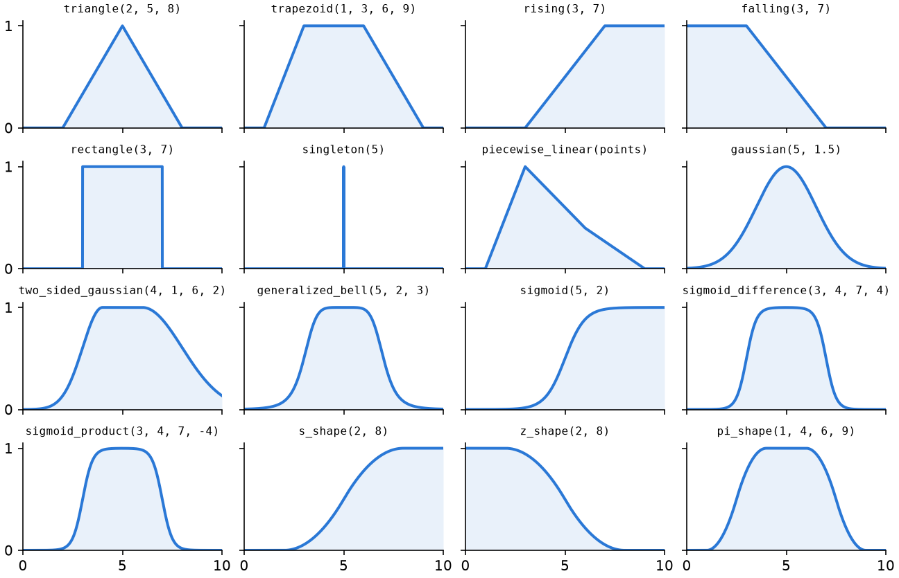
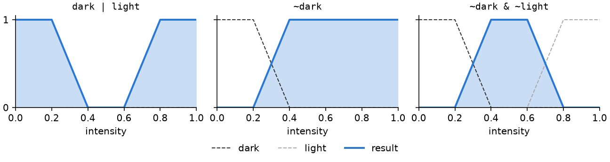
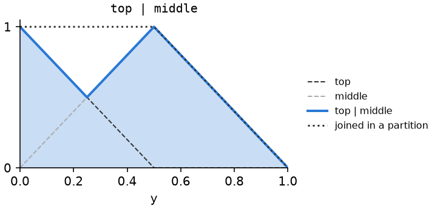

# fuzzy

Words describe values loosely: a point a quarter of the way down an image is
partly at the top, partly in the middle. Fuzzy logic says it in numbers, a
degree from 0 to 1 for every word.

```python
from emoge import fuzzy
```

Everything below is at `fuzzy.`. An axis can be anything: a place in an image,
the direction of a line, a share of the pixels, a channel of a color.

## A word is a fuzzy set

```python
most = fuzzy.rising(0.5, 0.8)  # on a share of the pixels
print(most.degrees([0.4, 0.65, 0.9]).tolist())  # [0.0, 0.5, 1.0]
```

Every shape below is made as its title reads. A function of your own,
`function(x, *parameters)`, makes a set with `fuzzy.FuzzySet(function, parameters)`.



Sets combine into new sets: `a & b` is the smaller degree, `a | b` the larger,
`~a` one minus it.

```python
dark = fuzzy.falling(0.2, 0.4)  # on intensity
light = fuzzy.rising(0.6, 0.8)
middle = ~dark & ~light  # neither dark nor light
print(middle.degrees([0.1, 0.5, 0.9]).tolist())  # [0.0, 1.0, 0.0]
```



## The words of an axis

A `Channel` is an axis of values and its range. `partition` makes the words of a
channel from their cores, the values that are fully each word; in between, one
word passes into the next and their degrees sum to 1. What it makes is a
`Variable`, a channel and its words.

```python
height = fuzzy.Channel("y", 0, 1)  # from the top of an image down
vertical = fuzzy.partition(height, {"top": 0, "middle": 0.5, "bottom": 1})
print(vertical.degrees(0.25).tolist())  # [0.5, 0.5, 0.0]
print(vertical.cores)  # {'top': (0, 0), 'middle': (0.5, 0.5), 'bottom': (1, 1)}
```

A partition keeps its cores, even after `select` leaves out some of its words,
so it can be saved, learned, or made again.

Neighbouring words overlap, so `|` of them dips where they cross. To join
neighbours, give `partition` one core for both:

```python
top_or_middle = vertical.terms["top"] | vertical.terms["middle"]
print(top_or_middle.degrees(0.25).tolist())  # 0.5
upper = fuzzy.partition(height, {"upper": (0, 0.5), "bottom": 1})
print(upper.degrees(0.25).tolist())  # [1.0, 0.0]
```



A periodic channel is a circle. A line turned by 180 degrees is the same line,
so horizontal runs across 0, and a line at 50 degrees is half horizontal, half
vertical:

```python
direction = fuzzy.Channel("direction", 0, 180, periodic=True)  # of a line, in degrees
lines = fuzzy.partition(direction, {"horizontal": (170, 10), "vertical": 90})
print(lines.degrees([185, 50]).tolist())  # [[1.0, 0.5], [0.0, 0.5]]
```

Words of any shape make a variable too: `fuzzy.Variable(channel, {"word": fuzzy_set})`.

## Joining degrees

`fuzzy.norms` joins two degrees into one: t-norms for "and", like `product` and
`minimum`, and s-norms for "or", like `probabilistic_sum` and `maximum`. Two
partitions joined with the product are a partition of both axes, here a soft
3 x 3 grid over an image:

```python
width = fuzzy.Channel("x", 0, 1)
horizontal = fuzzy.partition(width, {"left": 0, "center": 0.5, "right": 1})
down, across = vertical.degrees(0.25), horizontal.degrees(0.75)
cells = fuzzy.norms.product(down[:, None], across[None])
print(cells.tolist())  # [[0.0, 0.25, 0.25], [0.0, 0.25, 0.25], [0.0, 0.0, 0.0]]
```

A point a quarter of the way down and three quarters across shares four cells
equally.

## Sentences about many items

`truth(quantifier, degrees)` tells how true it is that a quantifier of the
items, like most of them, are as their degrees say. `among=` keeps the sentence
to a group, given by the degree of every item in it.

```python
dark = [0.9, 0.8, 0.2, 1.0]  # how dark each of four images is
fear = [1, 1, 0, 1]  # which of them are fearful
print(round(fuzzy.truth(most, dark), 2))  # 0.75
print(fuzzy.truth(most, dark, among=fear))  # 1.0
```

Of all four images, a share of 0.725 is dark, which is "most" to 0.75; of the
fearful ones, a share of 0.9, which is "most" fully.

## Plots

`plot_variable(variable)` draws the words of a variable and returns its Axes.
`emoge.fuzzy.plots.draw_terms` draws them on Axes you give, in colors you choose.
