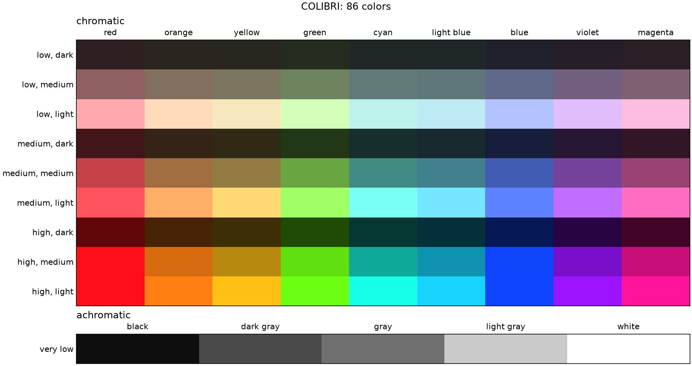
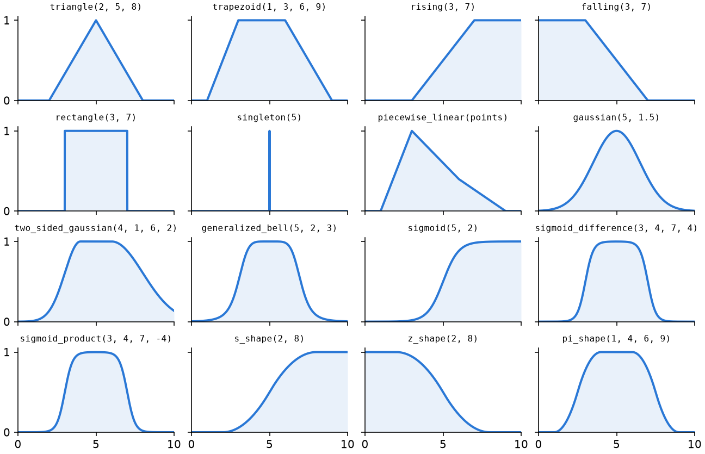
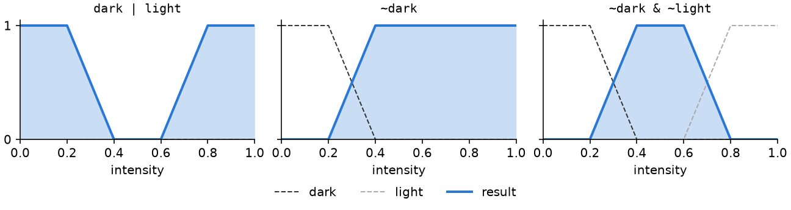
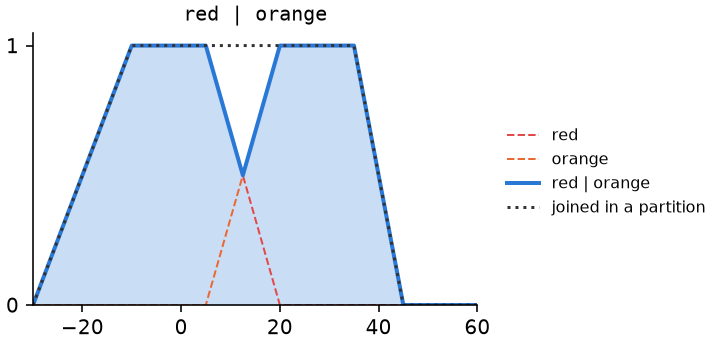
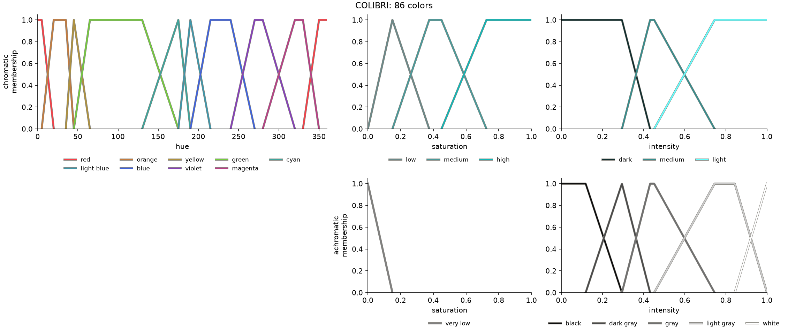

# fuzzy_color

People name colors loosely: an orange-red pixel is mostly orange, a little red.
A fuzzy color model says it in numbers, a degree from 0 to 1 for every color.

```python
import numpy as np
import emoge.fuzzy_color as fc
```

Everything below is at `fc.`.

## Naming colors

COLIBRI names 86 colors, after a survey of how people name them.

```python
image = np.array([[[200, 30, 30], [250, 220, 40]], [[30, 60, 200], [20, 20, 20]]])
print(fc.COLIBRI.label(image).tolist())
# [['red/high/dark', 'yellow/high/light'], ['blue/high/medium', 'black']]

degrees = fc.COLIBRI.degrees([230, 90, 40])  # an orange-red pixel
for i in np.argsort(-degrees)[:2]:
    print(fc.COLIBRI.colors[i], round(float(degrees[i]), 2))
# orange/high/medium 0.48
# red/high/medium 0.26
```

| Method | Gives |
|---|---|
| `degrees(rgb)` | the degree of every pixel in every color |
| `label(rgb)`, `classify(rgb)` | the strongest color: its name, or its index in `colors` |
| `strongest(rgb)` | the index of the strongest color and its degree |
| `palette(image)` | how much of the image each color takes |
| `prototypes()` | a typical RGB color for every color, as below |



For many images, `fc.lookup_table(fc.COLIBRI, "colibri.npz")` classifies every
8-bit pixel once and keeps the table in that file, 0.6 MB compressed; then
`table[red, green, blue]` classifies a whole image at once. `degree=True` keeps
the degree of each color too, in steps of 1/255.

## How a model works

A pixel first becomes hue, saturation and intensity, the channels of `HSI`.
Each channel is described by words, its terms, such as gray, pale and vivid
for saturation. A color takes one word per channel, like red, high, dark, and its
degree is the degrees of its words multiplied.

### A word is a fuzzy set

```python
vivid = fc.rising(0.25, 0.75)  # on saturation
print(vivid.degrees([0.1, 0.5, 0.9]).tolist())  # [0.0, 0.5, 1.0]
```

Every shape below is made as its title reads. A function of your own,
`function(x, *parameters)`, makes a set with `fc.FuzzySet(function, parameters)`.



Words combine into new words: `a & b` is the smaller degree, `a | b` the larger,
`~a` one minus it.

```python
dark = fc.falling(0.2, 0.4)  # on intensity
light = fc.rising(0.6, 0.8)
middle = ~dark & ~light  # neither dark nor light
print(middle.degrees([0.1, 0.5, 0.9]).tolist())  # [0.0, 1.0, 0.0]
```



Neighbouring words overlap, so `|` of them dips where they cross. To join
neighbours, give `partition` one core for both, as below.



### The words of a channel

`partition` makes the words of a channel from their cores, the values that are
fully each word; in between, one word passes into the next and their degrees sum
to 1.

```python
saturation = fc.partition(
    fc.HSI.channel("saturation"), {"gray": 0, "pale": 0.5, "vivid": 1}
)
print(saturation.degrees(0.25).tolist())  # [0.5, 0.5, 0.0]

hue = fc.partition(fc.HSI.channel("hue"), {"red": (350, 10), "green": 120, "blue": 240})
print(hue.degrees([355, -5, 180]).round(2).tolist())
# [[1.0, 1.0, 0.0], [0.0, 0.0, 0.5], [0.0, 0.0, 0.5]]
```

Hue is a circle: -5 is 355, and red runs across 0.

### Colors from words

A family takes one word from each of its channels; a model is its families.

```python
intensity = fc.partition(fc.HSI.channel("intensity"), {"dark": 0, "light": 1})
toy = fc.ColorModel(
    "toy",
    fc.HSI,
    {
        "tint": [hue, saturation.select("pale", "vivid")],
        "gray": [intensity, saturation.select("gray")],
    },
)
print(toy.colors)
# ('red/pale', 'red/vivid', 'green/pale', 'green/vivid', 'blue/pale', 'blue/vivid', 'dark', 'light')
print(toy.label([0, 0, 255]))  # blue/vivid
```

Gray has no hue, so its family leaves hue out. `and_norm=` joins the degrees of
the words in another way than the product: a t-norm from `fc.norms`.

## Color spaces

| Space | Channels |
|---|---|
| `HSI` | `hue` 0–360 around, `saturation`, `intensity` 0–1 |
| `HSV` | `hue` 0–360 around, `saturation`, `value` 0–1 |
| `RGB` | `red`, `green`, `blue` 0–1 |

`Space(name, channels, from_rgb, to_rgb)` adds one of your own.

## Plots

`plot_variable(variable)`, `plot_terms(model)`, `plot_swatches(model)` and
`plot_palette(model, weights)`; each returns its Axes.


